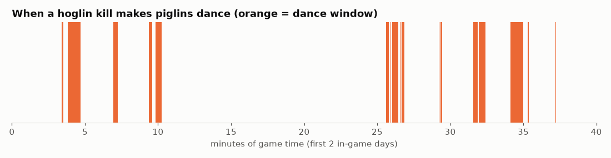
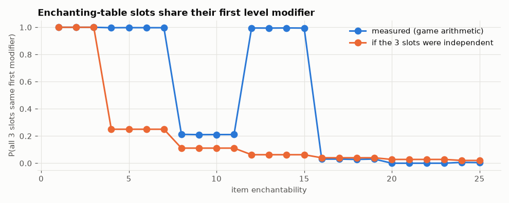

# Minecraft RNG Atlas

Every random number in Minecraft: Java Edition, mapped from the bytecode, logged while the game ran
(**37.1 billion draws** across 26.1.2, 26.2 and 26.3, every one replay-verified), then searched for correlations.

## Findings

| | Finding | Holds in |
|---|---|---|
| 🐷 | [**Piglin victory dances come in time windows.**](findings/01-piglin-dance-windows/) They're seeded with game time, so dances cluster into windows up to 51 s long with gaps up to 23 min, predictable from `/time query gametime`. | 26.1.2 – 26.3 |
| ✨ | [**The three enchanting-table offers share their first level modifier.**](findings/02-enchanting-slot-correlation/) Slots are seeded `s, s+1, s+2`; for enchantability 12–15 items all three match 99.5% of the time (6.2% if independent). | 26.1.2 – 26.3 |
| 🏛️ | [**Structure template palettes are spatially correlated**](findings/03-structure-palette-correlation/) (r ≈ 0.50 between consecutive placements). | 26.1.2 – 26.3 |
| ⛏️ | [**One chunk seed feeds unrelated generation steps**](findings/04-shared-chunk-seeds/): caves, mineshafts, ruined portals and initial mob spawns. | 26.3 |

## Sanity check: 19/19 known facts rediscovered

Without being told about any of them, the atlas finds slime-chunk and structure salts, enchantment-seed cracking,
player/entity RNG, bedrock patterns, stronghold rings, end pillars, goat horns, **jolt cracking** (the hunger bar
shakes from a HUD `Random` seeded with `tickCount * 312871`) and more. See [rediscovery/](rediscovery/).

## Across versions

| | 26.1.2 | 26.2 | 26.3 |
|---|---|---|---|
| RNG draws logged (all replay-verified, 0 mismatches) | 12.49 B | 12.48 B | 12.11 B |
| Known facts rediscovered | 19/19 | 19/19 | 19/19 |
| Enchanting-slot correlation r | 0.916 | 0.915 | 0.917 |
| Structure palette correlation r | 0.504 | 0.504 | 0.502 |

More comparisons in [charts/](charts/).

## Full database

The full dataset (~500 GB: every logged draw, per-generator and per-seed tables, static catalogs for six
versions) isn't hosted here. **DM `IWDissi_` on Discord** if you want it.

MIT licensed. Not affiliated with Mojang or Microsoft; no game code is included.
