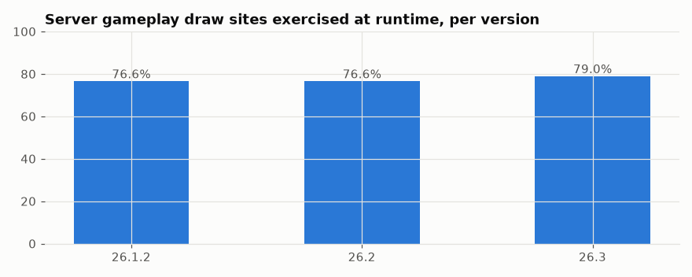
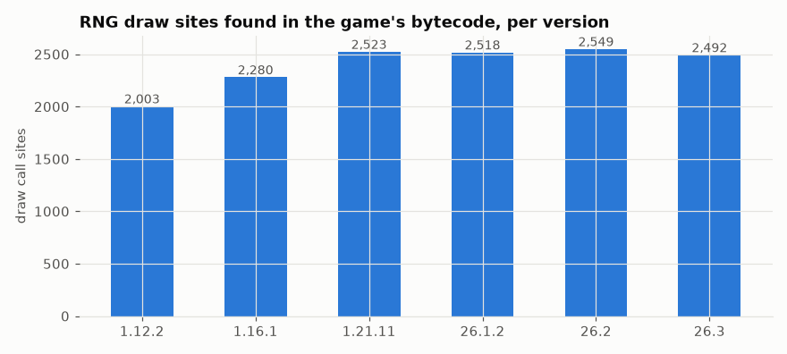
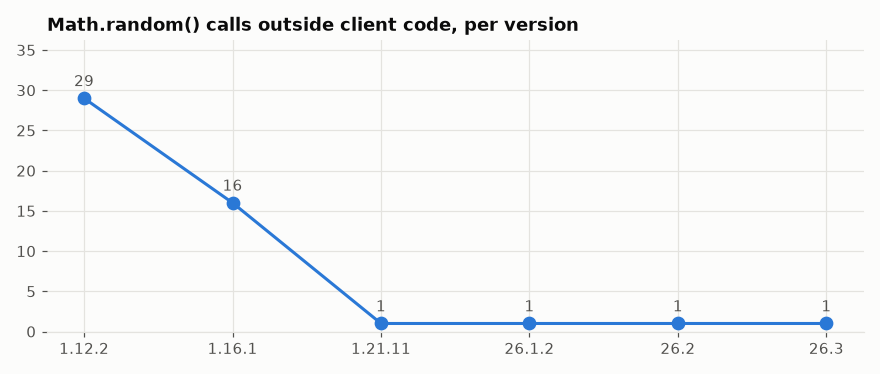
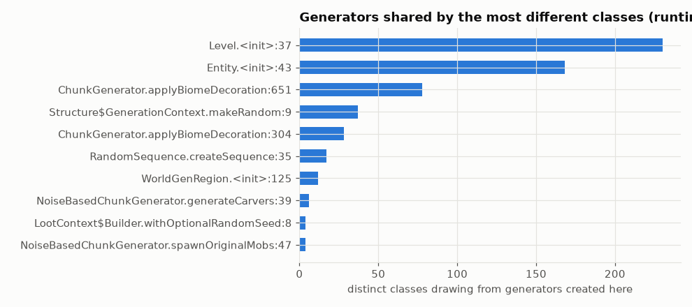
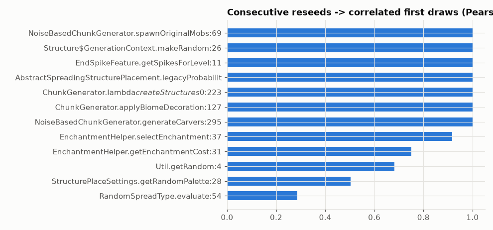
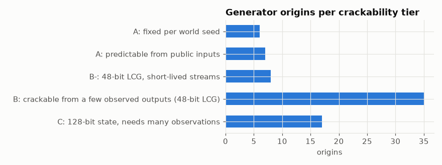
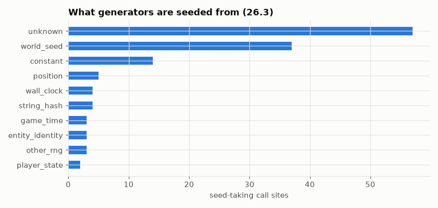
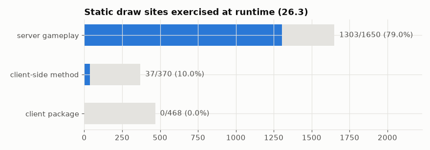

# Comparison charts

| Chart | What it compares |
|---|---|
|  | Share of server gameplay RNG code exercised at runtime, 26.1.2 vs 26.2 vs 26.3 |
|  | RNG draw sites in the bytecode, 1.12.2 → 26.3 |
|  | Unseeded `Math.random()` calls outside client code, per version |
|  | Generators shared by the most different parts of the game (26.3) |
|  | Strongest "nearby seeds → nearby outputs" correlations (26.3) |
|  | How predictable each generator origin is (26.3) |
|  | What generators are seeded from (26.3) |
|  | Server vs client RNG code exercised (26.3) |

Numbers per version: [cross-version.csv](cross-version.csv).
