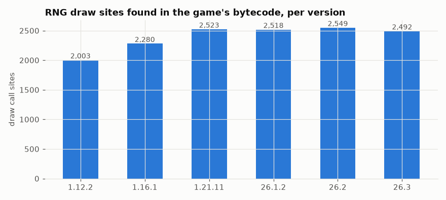

# Static catalog: every RNG call site in six versions

Every place in Minecraft: Java Edition's code that draws a random number, creates or reseeds a random generator, or uses unseeded global randomness (`Math.random`, `UUID.randomUUID`, `Collections.shuffle`).

## In simple terms

Researchers scanned the game's code without running it to find every place random numbers are used across six versions. The number of classes and random number types generally increased from version 1.12.2 to the latest snapshots. While the total number of places where random numbers are drawn grew over time, the count of unseeded global calls dropped significantly in newer versions. The data shows that generator fields peaked in version 1.21.11 before decreasing in subsequent updates.

Written by a local LLM (Qwen3.8-Flash-Next via llama.cpp) from the key numbers below and automatically checked: every number in it appears in those facts. The numbers below are authoritative.

## Key numbers

- 1.12.2: 3,310 classes, 7 RNG types, 41 generator fields, 2,003 draw sites, 84 unseeded global calls
- 1.16.1: 5,463 classes, 8 RNG types, 47 generator fields, 2,280 draw sites, 85 unseeded global calls
- 1.21.11: 10,291 classes, 16 RNG types, 57 generator fields, 2,523 draw sites, 19 unseeded global calls
- 26.1.2: 10,682 classes, 16 RNG types, 57 generator fields, 2,518 draw sites, 23 unseeded global calls
- 26.2: 10,952 classes, 16 RNG types, 56 generator fields, 2,549 draw sites, 26 unseeded global calls
- 26.3: 11,383 classes, 16 RNG types, 51 generator fields, 2,492 draw sites, 26 unseeded global calls

Draw call sites per version

## How this was produced

`atlas scan-all` parses every class file of the client jar (26.x are unobfuscated; 1.21.11 and 1.16.1 remapped with Mojang's mappings, 1.12.2 with MCP `stable_39`). No game code is included, only class/method names, bytecode offsets and classifications.

## Files

- [`summary.csv`](summary.csv): per-version totals
- [`sites-by-kind.csv`](sites-by-kind.csv): call sites per kind per version
- [`call-sites.csv`](call-sites.csv): every draw/construct/reseed/fork/derive/global call site (version, class, method, bytecode offset, target, generator identity)
- [`draw-sites-by-version.png`](draw-sites-by-version.png): chart
