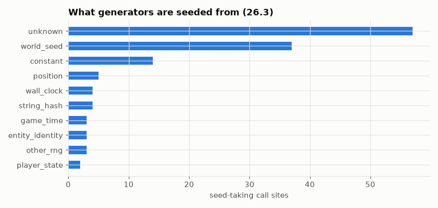

# Seed sources: what every generator is seeded from

Every place a generator is created with a seed, reseeded, or derived from a position, classified by what feeds the seed (world seed, game time, entity UUID, position, constants, the clock, …) and scored for how unusual that is.

## In simple terms

In version 26.3, researchers tracked 132 seed assignments across 124 locations where the game generates random content. Most of these spots use the world seed, but a significant number rely on unknown sources or fixed constants. The study highlights unusual cases where randomness depends on specific factors like a player's state or an entity's unique identity. For example, enchantment lists and goat horns use combinations of player data and world seeds that are considered rare.

Written by a local LLM (Qwen3.8-Flash-Next via llama.cpp) from the key numbers below and automatically checked: every number in it appears in those facts. The numbers below are authoritative.

## Key numbers

- 26.3 has 132 seed-category assignments across 124 seed-taking call sites
- 26.3 seeds from unknown: 57 sites
- 26.3 seeds from world_seed: 37 sites
- 26.3 seeds from constant: 14 sites
- 26.3 seeds from position: 5 sites
- 26.3 seeds from string_hash: 4 sites
- 26.3 seeds from wall_clock: 4 sites
- 26.3 seeds from entity_identity: 3 sites
- 26.3 seeds from other_rng: 3 sites
- 26.3 seeds from game_time: 3 sites
- 26.3 seeds from player_state: 2 sites
- most unusual: FishingHook.tick seeded from game_time,entity_identity (score 6)
- most unusual: DebugEntityNameGenerator.getEntityName seeded from entity_identity,string_hash (score 5)
- most unusual: EnchantmentMenu.getEnchantmentList seeded from player_state,world_seed (score 5)
- most unusual: EnchantmentMenu.lambda$slotsChanged$0 seeded from player_state,world_seed (score 5)
- most unusual: Goat.createHorn seeded from entity_identity,string_hash (score 5)

Seed categories in 26.3

## How this was produced

`atlas seeds` reads the instructions that compute the seed argument (scoped to the statement and followed through local variables) and classifies them by keyword. `unknown` mostly means the seed comes in as a method argument; interprocedural seed tracing is future work.

## Files

- [`seed-sources.csv`](seed-sources.csv): all versions, highest score first
- [`seed-categories-26.3.png`](seed-categories-26.3.png): chart
