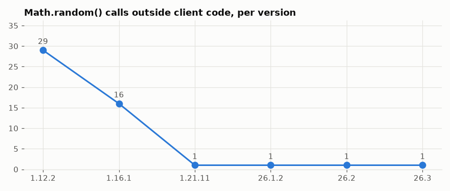

# Version differences

How RNG usage changed between versions: draw sites added and removed, and the move away from unseeded `Math.random`.

## In simple terms

Researchers tracked how random number generation changed across many Minecraft versions by counting where the game asks for a random value. Between version 1.16.1 and 1.21.11, they found 1335 new places using randomness and 1144 that were removed. In later updates like 26.1.2 through 26.3, the number of changes was much smaller, with counts like 52 added and 52 removed in one step. They also observed that the use of a specific random method outside the main game code dropped from 29 instances in 1.12.2 to just 1 in recent versions.

Written by a local LLM (Qwen3.8-Flash-Next via llama.cpp) from the key numbers below and automatically checked: every number in it appears in those facts. The numbers below are authoritative.

## Key numbers

- 1.16.1 -> 1.21.11: 1335 draw sites added, 1144 removed (compared by class, method and called RNG method)
- 1.21.11 -> 26.1.2: 52 draw sites added, 52 removed (compared by class, method and called RNG method)
- 26.1.2 -> 26.2: 46 draw sites added, 28 removed (compared by class, method and called RNG method)
- 26.2 -> 26.3: 70 draw sites added, 81 removed (compared by class, method and called RNG method)
- Math.random outside client code: 1.12.2 29, 1.16.1 16, 1.21.11 1, 26.1.2 1, 26.2 1, 26.3 1

Math.random calls per version

## How this was produced

Draw sites are compared by (class, method, called RNG method), because bytecode offsets shift between versions. Renames between mapping sets (MCP for 1.12.2) make the older comparisons noisier.

## Files

- [`diff-1.16.1-to-1.21.11.csv`](diff-1.16.1-to-1.21.11.csv): added/removed draw sites 1.16.1 -> 1.21.11
- [`diff-1.21.11-to-26.1.2.csv`](diff-1.21.11-to-26.1.2.csv): added/removed draw sites 1.21.11 -> 26.1.2
- [`diff-26.1.2-to-26.2.csv`](diff-26.1.2-to-26.2.csv): added/removed draw sites 26.1.2 -> 26.2
- [`diff-26.2-to-26.3.csv`](diff-26.2-to-26.3.csv): added/removed draw sites 26.2 -> 26.3
- [`math-random-by-version.png`](math-random-by-version.png): chart
