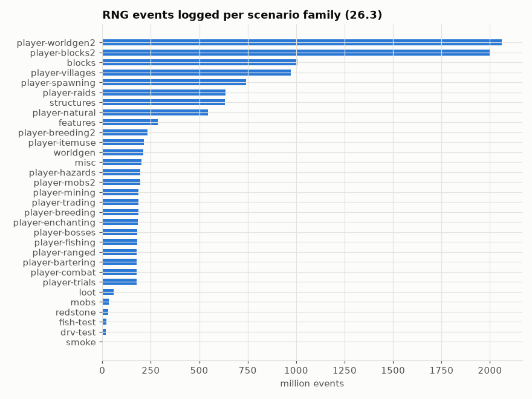

# Runtime runs: every RNG event, replayed and confirmed

Headless servers ran scripted scenarios (world generation, every feature/structure/loot table/mob, and fake players named `iwdissi_*` fishing, enchanting, trading, fighting, breeding, …) with a Java agent logging every random draw. Each generator's log was replayed: a draw is *confirmed* when its state matches the state predicted from the previous draw.

## In simple terms

Researchers ran automated tests on Minecraft servers to track every random event that occurred. They replayed these events to verify that the game's random number generator behaved exactly as predicted. Across versions 26.1.2, 26.2, and 26.3, billions of draws were confirmed with zero mismatches. This means the random outcomes in these tests matched the expected results perfectly every time.

Written by a local LLM (Qwen3.8-Flash-Next via llama.cpp) from the key numbers below and automatically checked: every number in it appears in those facts. The numbers below are authoritative.

## Key numbers

- 26.1.2: 146.0 runs, 12,493,552,328 events, 11,391,825,027 draws confirmed by replay, 0 mismatches
- 26.2: 145.0 runs, 12,478,981,084 events, 11,430,352,358 draws confirmed by replay, 0 mismatches
- 26.3: 148.0 runs, 12,111,530,459 events, 11,279,619,309 draws confirmed by replay, 0 mismatches

Events per scenario family

## How this was produced

`tools/run_many.py` (parallel servers) + `atlas ingest`. Raw events (~43 bytes each) are kept as Parquet locally and not committed (hundreds of GB); this folder has the per-run summary.

## Files

- [`runs.csv`](runs.csv): one row per run
- [`events-by-family.png`](events-by-family.png): chart
