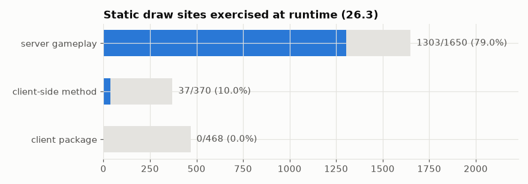

# Coverage: which RNG code actually ran

Which of the statically found draw sites were exercised by the runtime scenarios. Client code (particles, rendering, ambient sounds) only runs in a game client.

## In simple terms

The research checked which random number code actually ran during gameplay. Server gameplay triggered 79.0% of the identified code spots. Client-side methods only triggered 10.0% of theirs. The client package triggered none of its spots.

Written by a local LLM (Qwen3.8-Flash-Next via llama.cpp) from the key numbers below and automatically checked: every number in it appears in those facts. The numbers below are authoritative.

## Key numbers

- server gameplay: 1303 of 1650 draw sites exercised (79.0%)
- client-side method: 37 of 370 draw sites exercised (10.0%)
- client package: 0 of 468 draw sites exercised (0.0%)

Exercised vs total draw sites

## How this was produced

Join of the static `call_sites` table with runtime `rt_sites` on (class, method, original bytecode offset).

## Files

- [`draw-site-coverage-26.3.csv`](draw-site-coverage-26.3.csv): every 26.3 draw site with scope and whether it ran
- [`coverage.png`](coverage.png): chart
