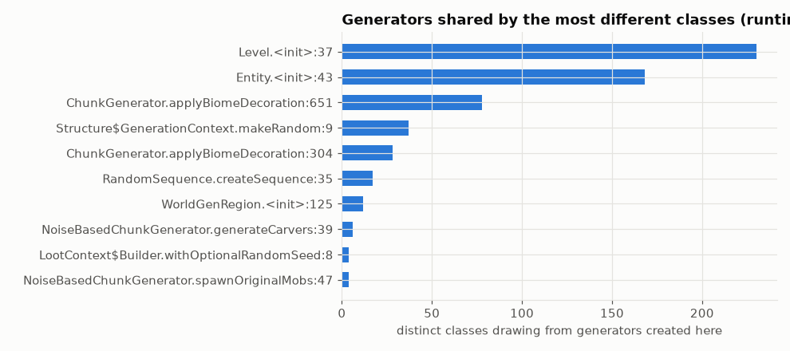

# Shared-generator graph

Which random generators are shared between which parts of the game, measured at runtime: each generator's creation site (origin) is linked to every draw site that consumed it. Outcomes that draw from the same generator are correlated.

## In simple terms

The game tracks which random number generators are shared across different parts of Minecraft. A single generator can be used by hundreds of different code locations, meaning outcomes from those locations are linked. For example, the main world setup uses one generator for over four billion draws across 230 classes. Entities and chunk decorations also rely on specific shared generators that feed into many other game features.

Written by a local LLM (Qwen3.8-Flash-Next via llama.cpp) from the key numbers below and automatically checked: every number in it appears in those facts. The numbers below are authoritative.

## Key numbers

- world/level/Level.<init>:37: generators created here feed 534 draw sites in 230 classes (4,057,203,212 draws)
- world/entity/Entity.<init>:43: generators created here feed 497 draw sites in 168 classes (206,601,168 draws)
- world/level/chunk/ChunkGenerator.applyBiomeDecoration:651: generators created here feed 234 draw sites in 78 classes (1,370,751,945 draws)
- world/level/levelgen/structure/Structure$GenerationContext.makeRandom:9: generators created here feed 114 draw sites in 37 classes (209,428,093 draws)
- world/level/chunk/ChunkGenerator.applyBiomeDecoration:304: generators created here feed 58 draw sites in 28 classes (6,044,604 draws)
- world/RandomSequence.createSequence:35: generators created here feed 25 draw sites in 17 classes (368,312 draws)

Most widely shared generator origins

## How this was produced

`atlas analyze`: per-generator first event = origin; edges = (origin, draw site) with event and generator counts.

## Files

- [`edges.csv`](edges.csv): origin -> draw site edges
- [`shared-generators.png`](shared-generators.png): chart
