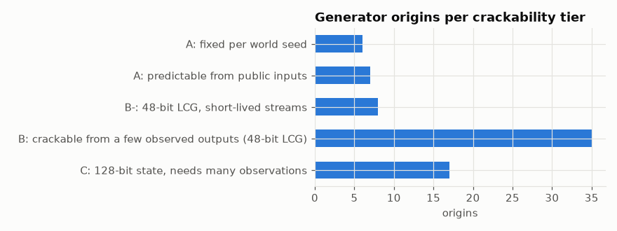

# Crackability tiers

A rough tier per generator origin: how hard it would be to predict its outputs.

## In simple terms

The dataset ranks random number generators by how difficult they are to predict based on their origin. The easiest tier uses fixed values tied to your world seed, while the next tier is predictable using public information. A middle tier relies on a 48-bit system that can be cracked with just a few observed outputs. The hardest tier uses a 128-bit state that requires many observations to figure out.

Written by a local LLM (Qwen3.8-Flash-Next via llama.cpp) from the key numbers below and automatically checked: every number in it appears in those facts. The numbers below are authoritative.

## Key numbers

- A: fixed per world seed: 6 origins, 121 generators, 728 draws
- A: predictable from public inputs: 7 origins, 41,707,248 generators, 42,324,753 draws
- B-: 48-bit LCG, short-lived streams: 8 origins, 23,189,927 generators, 12,343,183 draws
- B: crackable from a few observed outputs (48-bit LCG): 35 origins, 39,886,109 generators, 9,349,558,435 draws
- C: 128-bit state, needs many observations: 17 origins, 448,831,464 generators, 1,873,951,289 draws

Origins per tier

## How this was produced

Heuristic from state size (48-bit LCG vs 128-bit Xoroshiro), seed source, and stream length. It does not model what a player can actually observe.

## Files

- [`origins.csv`](origins.csv): per-origin statistics, seed categories and tier
- [`tiers.csv`](tiers.csv): tier totals
- [`tiers.png`](tiers.png): chart
