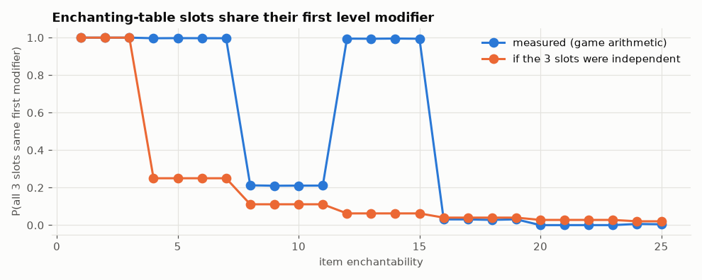

# Finding: the three enchanting-table offers share their first level modifier

The table seeds each offered slot with the player's enchantment seed plus 0, 1 or 2. Java's random generator gives almost the same first number for neighbouring seeds, and for power-of-two ranges `nextInt` uses exactly those high bits.

## In simple terms

The game uses a formula to generate enchanting table offers that is already known to some players. Because of this formula, the first part of the offer is often the same for all three slots. This happens 0.995 of the time for certain items, which is much higher than if the slots were random. For other items, this sharing does not happen at all. This specific result has not been written up before, so it is currently just a candidate finding.

Written by a local LLM (Qwen3.8-Flash-Next via llama.cpp) from the key numbers below and automatically checked: every number in it appears in those facts. The numbers below are authoritative.

## Key numbers

- code: EnchantmentMenu.getEnchantmentList calls setSeed(enchantmentSeed + slot) for slots 0, 1, 2
- first draw in selectEnchantment: nextInt(enchantability / 4 + 1)
- runtime: lag-1 correlation of that first draw across consecutive reseeds r = 0.917 over 519,129 pairs
- enchantability 12-15 (bound 4): all three slots share the first modifier 0.995 of the time vs 0.0625 if independent
- enchantability 22-23 (bound 6): 0.000 vs 0.0278 if independent
- status: candidate (seed + slot formula is known to enchantment crackers; this consequence not found written up)

Probability that all three slots share the first modifier

Fake player `iwdissi_ench7` at a 15-bookshelf table (in-game)

## How this was produced

Bytecode of `EnchantmentMenu.getEnchantmentList` / `EnchantmentHelper.selectEnchantment` (26.3), runtime segment statistics from fake player `iwdissi_ench*` enchanting at tables with 0–15 bookshelves, and the exact game arithmetic over 20,000 random enchantment seeds per enchantability.

## Files

- [`same-modifier-probability.csv`](same-modifier-probability.csv): probability per enchantability
- [`same-modifier.png`](same-modifier.png): chart
