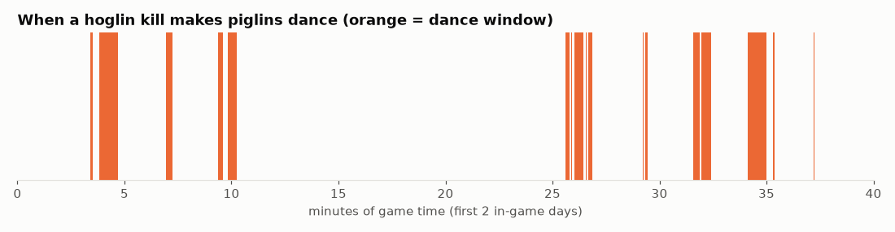

# Finding: piglin victory dances come in time windows

Piglins that kill a hoglin dance 10% of the time, but the roll is seeded with the world's game time. Consecutive game times give nearly the same first random number, so dance ticks cluster into windows.

## In simple terms

Piglins only perform victory dances during specific time windows that depend on the current game time. These windows occur about ten percent of the time, with the longest lasting just over fifty seconds. Between these active periods, there are often long gaps where dancing is impossible, sometimes lasting up to twenty-three minutes. This behavior is currently considered a candidate finding because the specific timing consequence has not been officially documented.

Written by a local LLM (Qwen3.8-Flash-Next via llama.cpp) from the key numbers below and automatically checked: every number in it appears in those facts. The numbers below are authoritative.

## Key numbers

- code rule: dance if RandomSource.createThreadLocalInstance(gameTime).nextFloat() < 0.1
- fraction of game ticks that are dance ticks over 40 in-game days: 0.1000
- dance windows: 596, mean 161 ticks, longest 1024 ticks (51 seconds)
- gaps without dancing: mean 1447 ticks, longest 27408 ticks (23 minutes)
- status: candidate (seed source mentioned in a third-party PR; the windowing consequence not found documented)

Dance windows over two in-game days

Test scene: piglin and hoglin (in-game, client `iwdissi`)

## How this was produced

Bytecode of `PiglinAi.wantsToDance` (26.3) + replaying the game's exact LCG arithmetic (`SingleThreadedRandomSource`: setSeed scramble, `next(24)`) for every tick of 40 in-game days.

## Files

- [`dance-windows.csv`](dance-windows.csv): every dance / no-dance window (start tick, length)
- [`dance-timeline.png`](dance-timeline.png): chart
