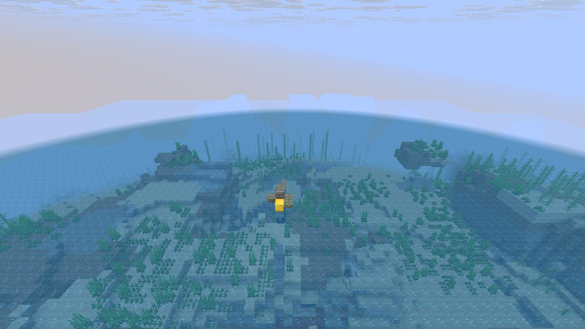

# Finding: structure template palettes are spatially correlated

When a structure template is placed without its own random, its palette/processor random is seeded from a hash of the block position, so nearby placements make related choices.

## In simple terms

When a structure is placed without its own random setting, the game uses the block position to decide which blocks appear. This means nearby structures often make similar choices because their positions are close together. Researchers tested this and found a strong statistical bias in the first block chosen. The current status of this finding is that it is a candidate for further confirmation.

Written by a local LLM (Qwen3.8-Flash-Next via llama.cpp) from the key numbers below and automatically checked: every number in it appears in those facts. The numbers below are authoritative.

## Key numbers

- StructurePlaceSettings.getRandomPalette:28: r = 0.502 over 10,825,301.0 consecutive placements
- StructurePlaceSettings.getRandomPalette:28: first-draw bias z = 7339 over 10,825,447.0 placements
- seed: RandomSource.create(Mth.getSeed(pos)) when no random is set (position hash)
- status: candidate

Placed structures (in-game)

## How this was produced

Runtime segment statistics over all structure placements in the scenario runs.

## Files

- [`serial.csv`](serial.csv): lag-1 correlation
- [`bias.csv`](bias.csv): first-draw uniformity
