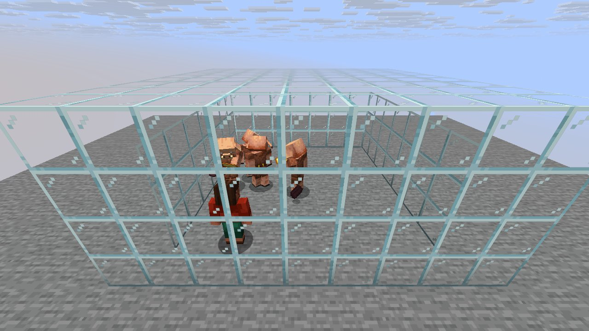
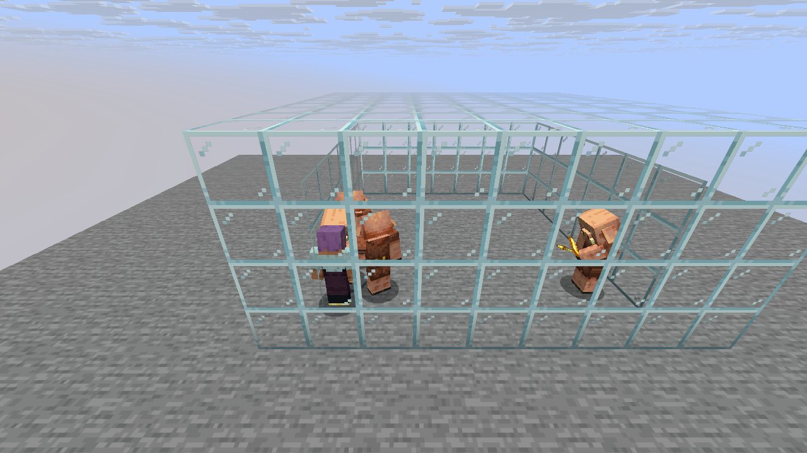

# Mechanic: bartering

Scenario family `bartering`: fake players `iwdissi_*` exercising this mechanic.

## In simple terms

This research tracks how the game generates worlds using random numbers across four different maps. The data shows that creating tunnels was the most frequent activity, followed by setting up vertical gradients and carving out chunks. Other common tasks included updating chunks, shuffling items, and placing ores or canyons.

Written by a local LLM (Qwen3.8-Flash-Next via llama.cpp) from the key numbers below and automatically checked: every number in it appears in those facts. The numbers below are authoritative.

## Key numbers

- 4 runs (4 world seeds), 177,844,883 RNG events, 243 distinct draw sites
- CaveWorldCarver.createTunnel: 69,412,486 draws
- VerticalGradientCondition$1.compute: 16,241,070 draws
- NoiseBasedChunkGenerator.generateCarvers: 15,884,759 draws
- ServerLevel.tickChunk: 13,588,560 draws
- Util.shuffle: 8,318,532 draws
- OreFeature.doPlace: 7,574,862 draws
- InSquarePlacement.modify: 6,170,926 draws
- CanyonWorldCarver.initWidthFactors: 5,200,580 draws

In-game: station 0

In-game: station 1

## How this was produced

Driver script `scenarios/gen/player-bartering-<seed>.drv` (generated by `tools/gen_player_scenarios.py`), run on 26.3 for 4 world seeds; fake players are real server players named `iwdissi_<role><n>`.

## Files

- [`draw-sites.csv`](draw-sites.csv): every draw site this family exercised, with draw counts
