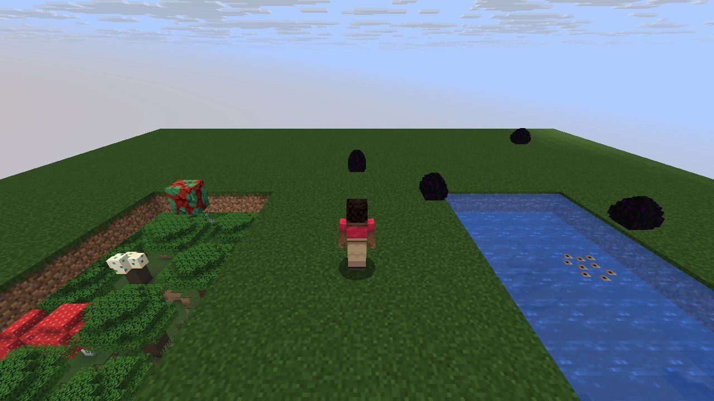
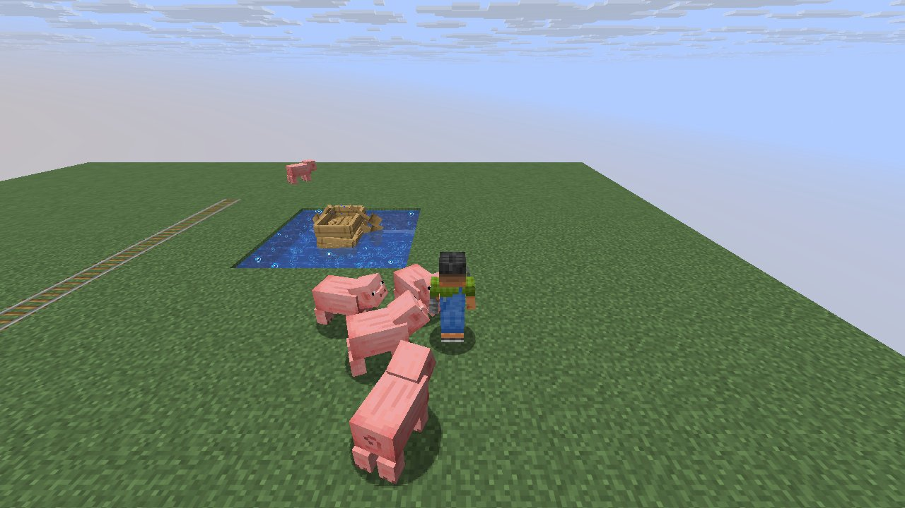

# Mechanic: blocks2

Player-driven block interactions and block entities.

## In simple terms

This research tracked how the game uses random numbers during block interactions across four different worlds. The vast majority of these random choices happened while the game updated chunks and spread snow. Other significant uses included carving tunnels, moving lava, and placing ores. The study recorded nearly two billion total random events across three hundred specific locations.

Written by a local LLM (Qwen3.8-Flash-Next via llama.cpp) from the key numbers below and automatically checked: every number in it appears in those facts. The numbers below are authoritative.

## Key numbers

- 4 runs (4 world seeds), 1,997,781,509 RNG events, 300 distinct draw sites
- ServerLevel.tickChunk: 1,358,838,702 draws
- SpreadingSnowyBlock.randomTick: 405,465,805 draws
- CaveWorldCarver.createTunnel: 72,113,190 draws
- LavaFluid.randomTick: 31,553,926 draws
- VerticalGradientCondition$1.compute: 17,094,864 draws
- NoiseBasedChunkGenerator.generateCarvers: 16,712,036 draws
- Util.shuffle: 9,566,777 draws
- OreFeature.doPlace: 7,934,256 draws

In-game: station 0

In-game: station 1

## How this was produced

Driver script `scenarios/gen/player-blocks2-<seed>.drv` (generated by `tools/gen_player_scenarios.py`), run on 26.3 for 4 world seeds; fake players are real server players named `iwdissi_<role><n>`.

## Files

- [`draw-sites.csv`](draw-sites.csv): every draw site this family exercised, with draw counts
