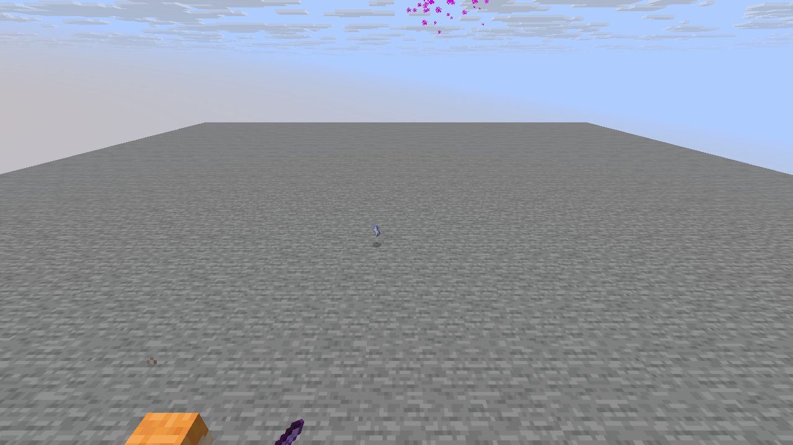
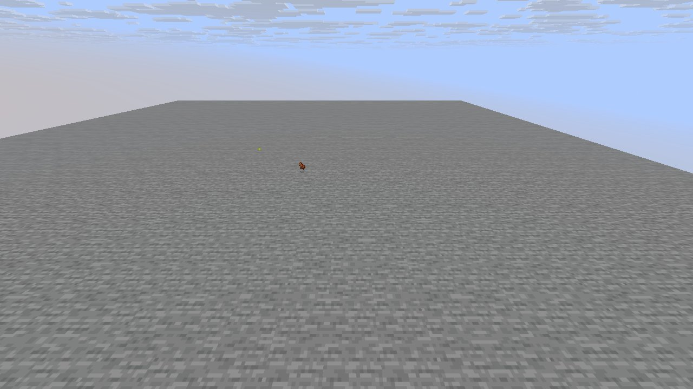

# Mechanic: bosses

Scenario family `bosses`: fake players `iwdissi_*` exercising this mechanic.

## In simple terms

The research involved four runs across different world seeds to study the bosses mechanic. These runs recorded a total of 179,433,537 random number events at 270 distinct locations. The most frequent activity was creating tunnels, which accounted for 69,412,486 of those events. Other common activities included calculating vertical gradients and generating carvers.

Written by a local LLM (Qwen3.8-Flash-Next via llama.cpp) from the key numbers below and automatically checked: every number in it appears in those facts. The numbers below are authoritative.

## Key numbers

- 4 runs (4 world seeds), 179,433,537 RNG events, 270 distinct draw sites
- CaveWorldCarver.createTunnel: 69,412,486 draws
- VerticalGradientCondition$1.compute: 16,241,070 draws
- NoiseBasedChunkGenerator.generateCarvers: 15,884,759 draws
- ServerLevel.tickChunk: 13,580,727 draws
- Util.shuffle: 8,328,531 draws
- OreFeature.doPlace: 7,574,760 draws
- InSquarePlacement.modify: 6,170,926 draws
- CanyonWorldCarver.initWidthFactors: 5,200,580 draws

In-game: station 0

In-game: station 1

## How this was produced

Driver script `scenarios/gen/player-bosses-<seed>.drv` (generated by `tools/gen_player_scenarios.py`), run on 26.3 for 4 world seeds; fake players are real server players named `iwdissi_<role><n>`.

## Files

- [`draw-sites.csv`](draw-sites.csv): every draw site this family exercised, with draw counts
