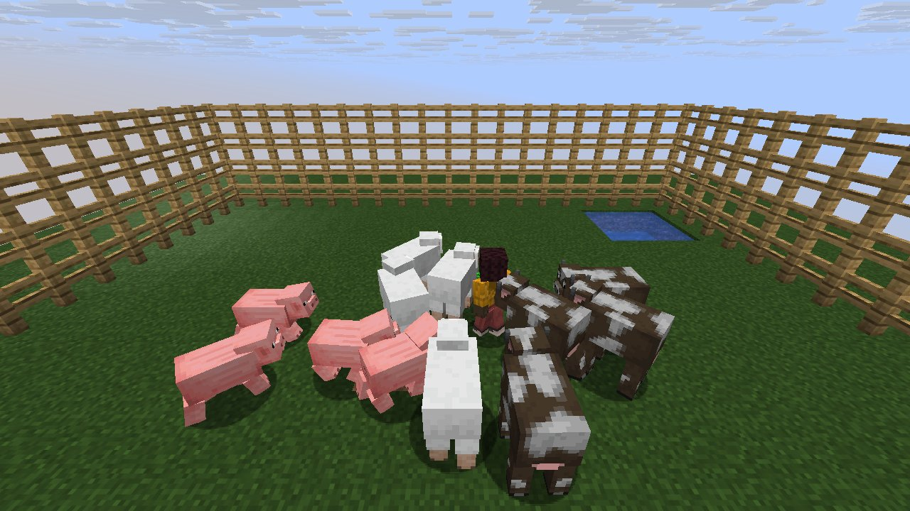
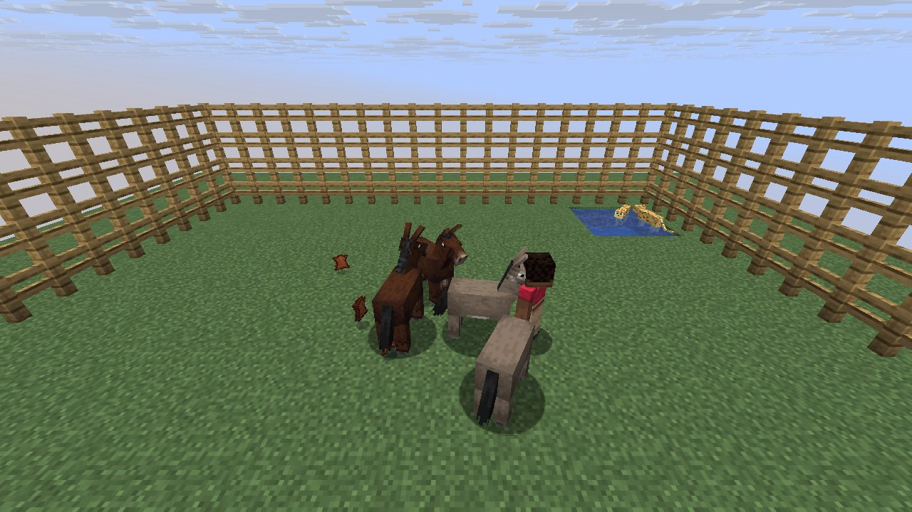

# Mechanic: breeding

Scenario family `breeding`: fake players `iwdissi_*` exercising this mechanic.

## In simple terms

The research tracked breeding mechanics using fake players across four world seeds. These runs recorded 186,375,876 random events at 301 distinct locations. The most frequent activity was creating tunnels, which happened 69,412,486 times. Other common tasks included calculating vertical gradients and generating carvers.

Written by a local LLM (Qwen3.8-Flash-Next via llama.cpp) from the key numbers below and automatically checked: every number in it appears in those facts. The numbers below are authoritative.

## Key numbers

- 4 runs (4 world seeds), 186,375,876 RNG events, 301 distinct draw sites
- CaveWorldCarver.createTunnel: 69,412,486 draws
- VerticalGradientCondition$1.compute: 16,241,070 draws
- NoiseBasedChunkGenerator.generateCarvers: 15,884,759 draws
- ServerLevel.tickChunk: 13,583,730 draws
- Util.shuffle: 8,313,998 draws
- OreFeature.doPlace: 7,575,338 draws
- InSquarePlacement.modify: 6,170,924 draws
- CanyonWorldCarver.initWidthFactors: 5,200,580 draws

In-game: station 0

In-game: station 1

## How this was produced

Driver script `scenarios/gen/player-breeding-<seed>.drv` (generated by `tools/gen_player_scenarios.py`), run on 26.3 for 4 world seeds; fake players are real server players named `iwdissi_<role><n>`.

## Files

- [`draw-sites.csv`](draw-sites.csv): every draw site this family exercised, with draw counts
