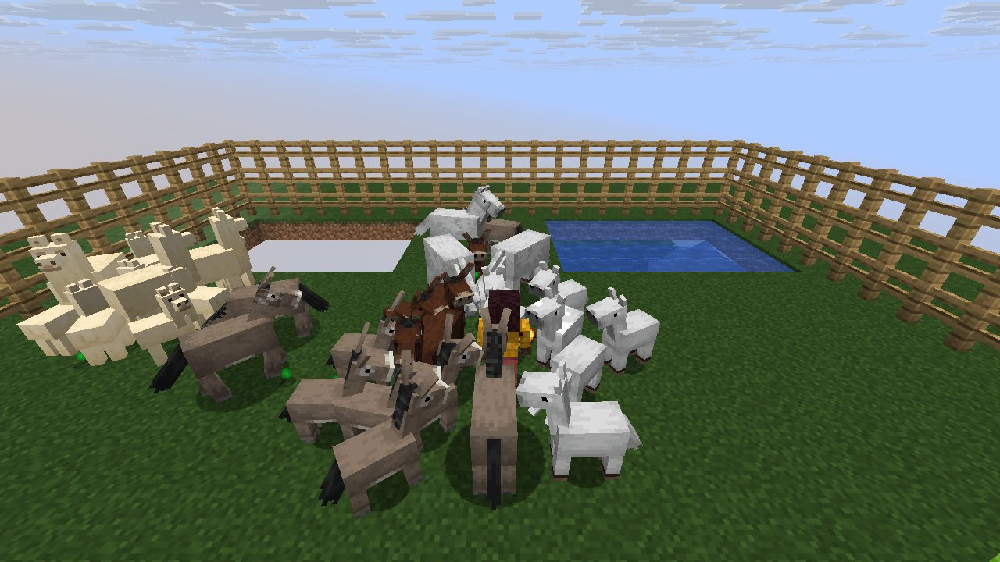
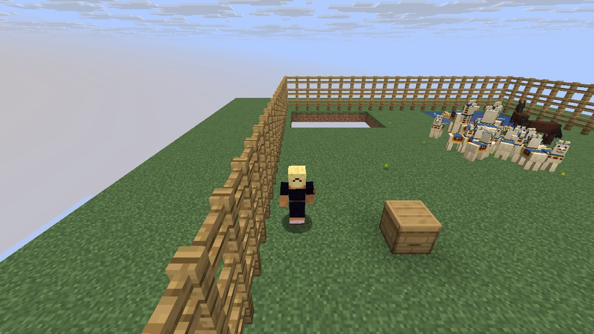

# Mechanic: breeding2

Breeding forced with InLove, owners for tameables, plus panda personalities and turtles laying eggs.

## In simple terms

The study examined breeding mechanics by running four world seeds that produced 232,192,507 random events across 325 different locations. Most of these random draws happened during cave tunnel creation, followed by vertical gradient calculations and chunk generation. Other significant activity occurred during server chunk ticking, mob base ticks, and horse AI steps. The data also included draws from shuffling utilities and ore placement features.

Written by a local LLM (Qwen3.8-Flash-Next via llama.cpp) from the key numbers below and automatically checked: every number in it appears in those facts. The numbers below are authoritative.

## Key numbers

- 4 runs (4 world seeds), 232,192,507 RNG events, 325 distinct draw sites
- CaveWorldCarver.createTunnel: 69,412,486 draws
- VerticalGradientCondition$1.compute: 16,241,070 draws
- NoiseBasedChunkGenerator.generateCarvers: 15,884,759 draws
- ServerLevel.tickChunk: 13,587,289 draws
- Mob.baseTick: 12,634,179 draws
- AbstractHorse.aiStep: 10,102,494 draws
- Util.shuffle: 8,317,481 draws
- OreFeature.doPlace: 7,574,964 draws

In-game: station 0

In-game: station 1

## How this was produced

Driver script `scenarios/gen/player-breeding2-<seed>.drv` (generated by `tools/gen_player_scenarios.py`), run on 26.3 for 4 world seeds; fake players are real server players named `iwdissi_<role><n>`.

## Files

- [`draw-sites.csv`](draw-sites.csv): every draw site this family exercised, with draw counts
