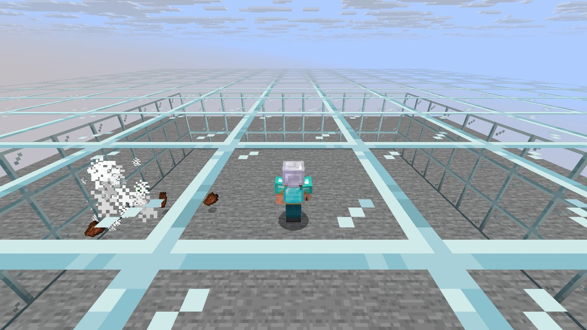
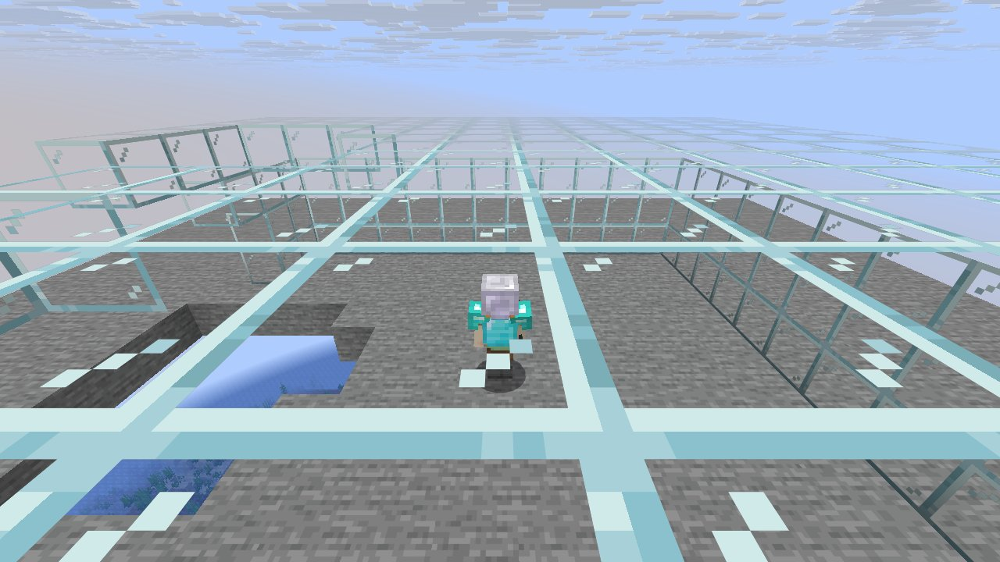

# Mechanic: combat

Scenario family `combat`: fake players `iwdissi_*` exercising this mechanic.

## In simple terms

Researchers ran 4 tests using fake players to study how combat works in the game. These tests recorded 177,659,575 random events across 266 different locations. The most frequent activity was creating tunnels, which happened 69,412,486 times. Other common actions included calculating vertical gradients and generating cave carvers.

Written by a local LLM (Qwen3.8-Flash-Next via llama.cpp) from the key numbers below and automatically checked: every number in it appears in those facts. The numbers below are authoritative.

## Key numbers

- 4 runs (4 world seeds), 177,659,575 RNG events, 266 distinct draw sites
- CaveWorldCarver.createTunnel: 69,412,486 draws
- VerticalGradientCondition$1.compute: 16,241,070 draws
- NoiseBasedChunkGenerator.generateCarvers: 15,884,759 draws
- ServerLevel.tickChunk: 13,584,882 draws
- Util.shuffle: 8,319,126 draws
- OreFeature.doPlace: 7,574,692 draws
- InSquarePlacement.modify: 6,170,926 draws
- CanyonWorldCarver.initWidthFactors: 5,200,580 draws

In-game: station 0

In-game: station 1

## How this was produced

Driver script `scenarios/gen/player-combat-<seed>.drv` (generated by `tools/gen_player_scenarios.py`), run on 26.3 for 4 world seeds; fake players are real server players named `iwdissi_<role><n>`.

## Files

- [`draw-sites.csv`](draw-sites.csv): every draw site this family exercised, with draw counts
