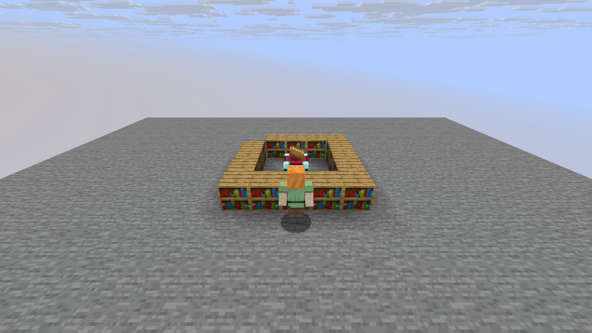
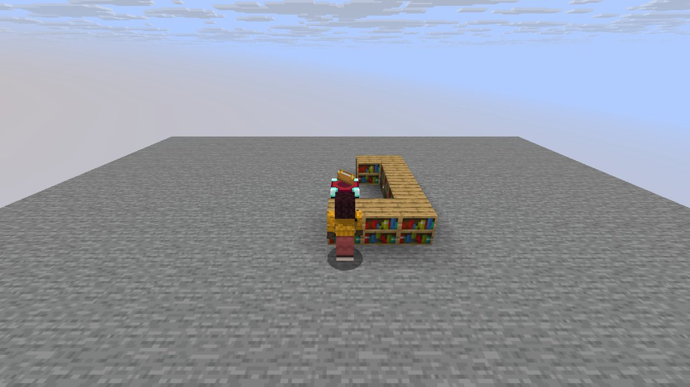

# Mechanic: enchanting

Scenario family `enchanting`: fake players `iwdissi_*` exercising this mechanic.

## In simple terms

The research involved four runs across four world seeds, totaling 182,458,344 random number events at 245 distinct locations. Fake players named iwdissi_* were used to test how the enchanting mechanic works. The largest source of these events was cave tunnel creation, which accounted for 69,412,486 draws. Other significant sources included vertical gradient calculations and chunk generation noise.

Written by a local LLM (Qwen3.8-Flash-Next via llama.cpp) from the key numbers below and automatically checked: every number in it appears in those facts. The numbers below are authoritative.

## Key numbers

- 4 runs (4 world seeds), 182,458,344 RNG events, 245 distinct draw sites
- CaveWorldCarver.createTunnel: 69,412,486 draws
- VerticalGradientCondition$1.compute: 16,241,070 draws
- NoiseBasedChunkGenerator.generateCarvers: 15,884,759 draws
- ServerLevel.tickChunk: 13,586,316 draws
- Util.shuffle: 8,317,880 draws
- OreFeature.doPlace: 7,574,760 draws
- InSquarePlacement.modify: 6,170,924 draws
- CanyonWorldCarver.initWidthFactors: 5,200,580 draws

In-game: station 0

In-game: station 1

## How this was produced

Driver script `scenarios/gen/player-enchanting-<seed>.drv` (generated by `tools/gen_player_scenarios.py`), run on 26.3 for 4 world seeds; fake players are real server players named `iwdissi_<role><n>`.

## Files

- [`draw-sites.csv`](draw-sites.csv): every draw site this family exercised, with draw counts
