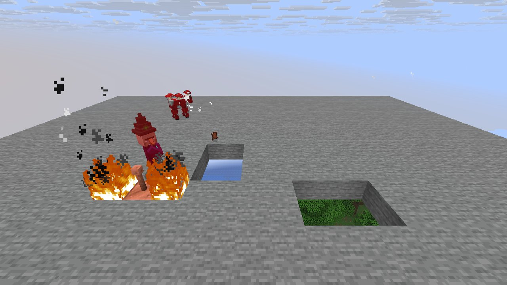
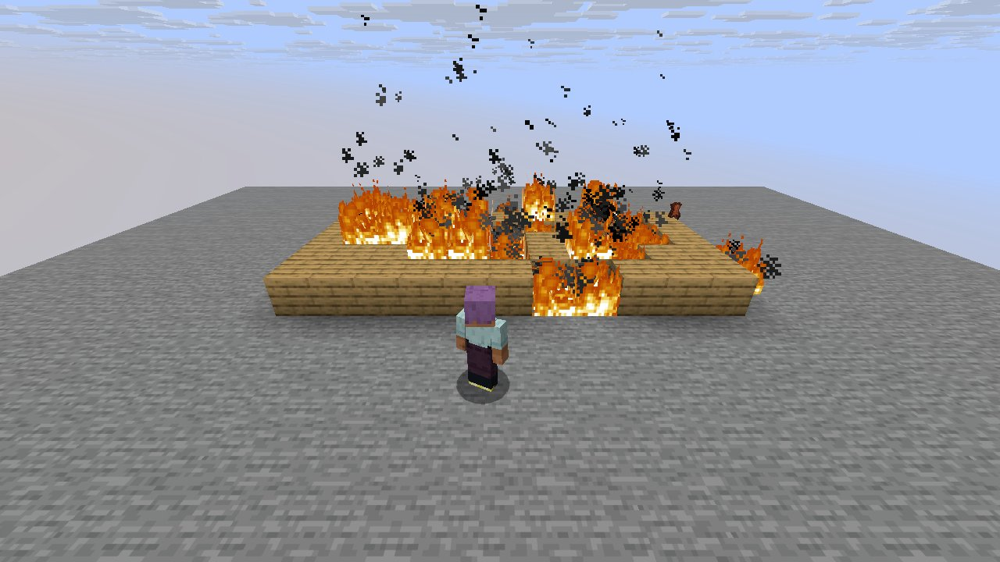

# Mechanic: hazards

Scenario family `hazards`: fake players `iwdissi_*` exercising this mechanic.

## In simple terms

A group of fake players tested the hazards mechanic across 4 runs with 4 world seeds. This testing recorded 195,876,753 random events at 290 distinct draw sites. The most frequent activity was creating tunnels, which accounted for 73,590,721 draws. Other common tasks included calculating vertical gradients and generating carvers.

Written by a local LLM (Qwen3.8-Flash-Next via llama.cpp) from the key numbers below and automatically checked: every number in it appears in those facts. The numbers below are authoritative.

## Key numbers

- 4 runs (4 world seeds), 195,876,753 RNG events, 290 distinct draw sites
- CaveWorldCarver.createTunnel: 73,590,721 draws
- VerticalGradientCondition$1.compute: 17,212,626 draws
- NoiseBasedChunkGenerator.generateCarvers: 16,800,487 draws
- ServerLevel.tickChunk: 13,604,535 draws
- Util.shuffle: 8,859,875 draws
- OreFeature.doPlace: 8,067,356 draws
- InSquarePlacement.modify: 6,565,328 draws
- CanyonWorldCarver.initWidthFactors: 5,471,209 draws

In-game: station 0

In-game: station 1

## How this was produced

Driver script `scenarios/gen/player-hazards-<seed>.drv` (generated by `tools/gen_player_scenarios.py`), run on 26.3 for 4 world seeds; fake players are real server players named `iwdissi_<role><n>`.

## Files

- [`draw-sites.csv`](draw-sites.csv): every draw site this family exercised, with draw counts
