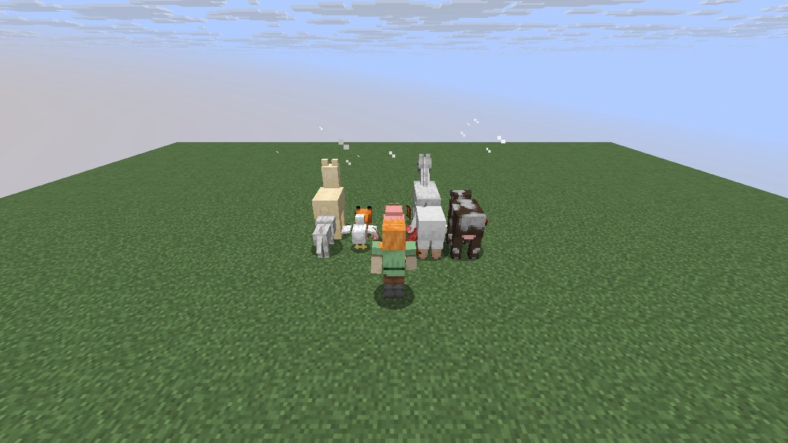
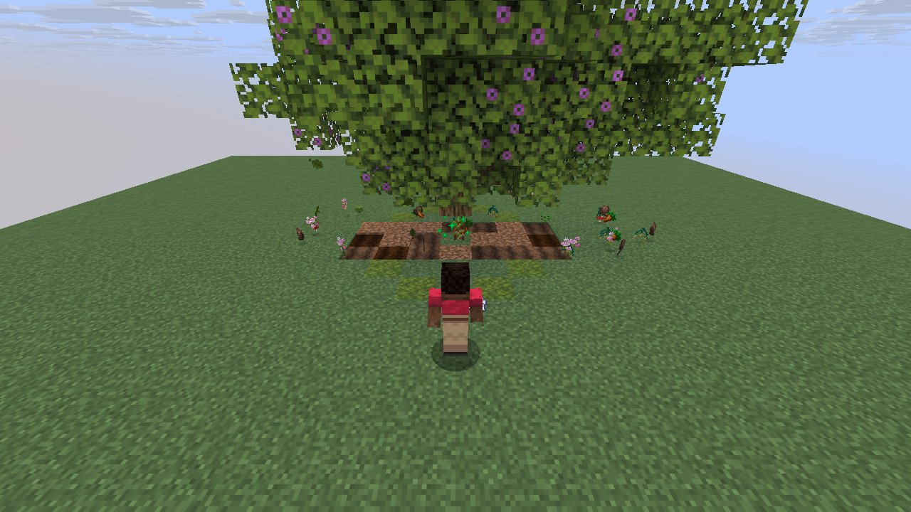

# Mechanic: itemuse

Scenario family `itemuse`: fake players `iwdissi_*` exercising this mechanic.

## In simple terms

The researchers ran four tests using fake players to study how items are used. These runs recorded 216,060,679 random number events across 294 different places in the code. The most frequent activity was creating tunnels, which happened 83,511,461 times. Other common tasks included calculating vertical gradients and generating cave carvers.

Written by a local LLM (Qwen3.8-Flash-Next via llama.cpp) from the key numbers below and automatically checked: every number in it appears in those facts. The numbers below are authoritative.

## Key numbers

- 4 runs (4 world seeds), 216,060,679 RNG events, 294 distinct draw sites
- CaveWorldCarver.createTunnel: 83,511,461 draws
- VerticalGradientCondition$1.compute: 19,678,226 draws
- NoiseBasedChunkGenerator.generateCarvers: 19,438,408 draws
- ServerLevel.tickChunk: 13,656,640 draws
- OreFeature.doPlace: 9,394,244 draws
- Util.shuffle: 8,310,931 draws
- InSquarePlacement.modify: 7,650,626 draws
- CanyonWorldCarver.initWidthFactors: 6,438,142 draws

In-game: station 0

In-game: station 1

## How this was produced

Driver script `scenarios/gen/player-itemuse-<seed>.drv` (generated by `tools/gen_player_scenarios.py`), run on 26.3 for 4 world seeds; fake players are real server players named `iwdissi_<role><n>`.

## Files

- [`draw-sites.csv`](draw-sites.csv): every draw site this family exercised, with draw counts
