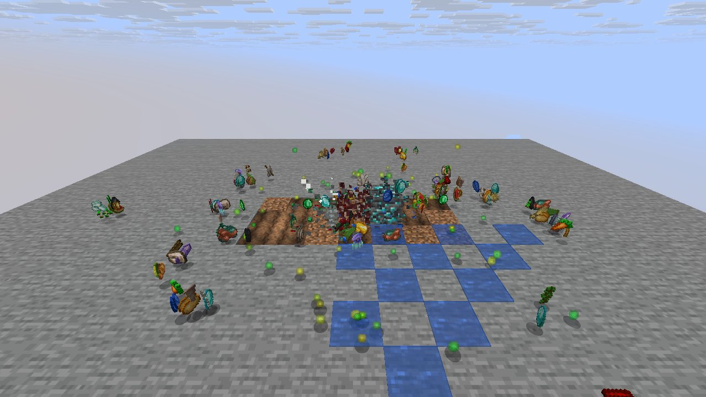
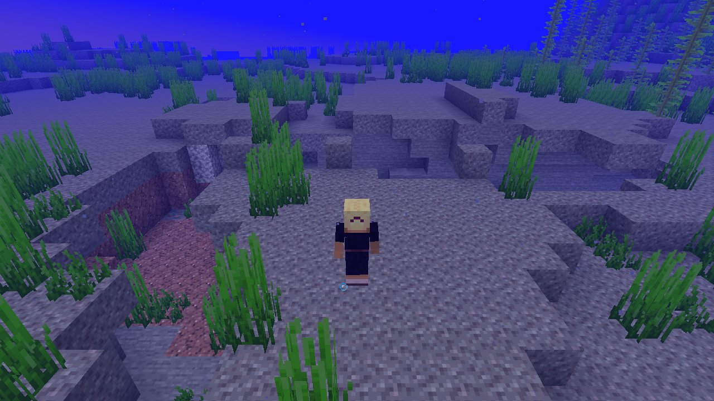

# Mechanic: mining

Scenario family `mining`: fake players `iwdissi_*` exercising this mechanic.

## In simple terms

The research tracked fake players mining across four world seeds. These sessions recorded 186,827,103 random number events at 249 distinct locations. The most frequent activity was creating tunnels, which happened 69,412,486 times. Other common actions included calculating vertical gradients and generating cave carvers.

Written by a local LLM (Qwen3.8-Flash-Next via llama.cpp) from the key numbers below and automatically checked: every number in it appears in those facts. The numbers below are authoritative.

## Key numbers

- 4 runs (4 world seeds), 186,827,103 RNG events, 249 distinct draw sites
- CaveWorldCarver.createTunnel: 69,412,486 draws
- VerticalGradientCondition$1.compute: 16,241,070 draws
- NoiseBasedChunkGenerator.generateCarvers: 15,884,759 draws
- ServerLevel.tickChunk: 13,585,087 draws
- Util.shuffle: 8,317,350 draws
- OreFeature.doPlace: 7,575,440 draws
- Entity.doWaterSplashEffect: 7,219,198 draws
- InSquarePlacement.modify: 6,170,924 draws

In-game: station 0

In-game: station 1

## How this was produced

Driver script `scenarios/gen/player-mining-<seed>.drv` (generated by `tools/gen_player_scenarios.py`), run on 26.3 for 4 world seeds; fake players are real server players named `iwdissi_<role><n>`.

## Files

- [`draw-sites.csv`](draw-sites.csv): every draw site this family exercised, with draw counts
