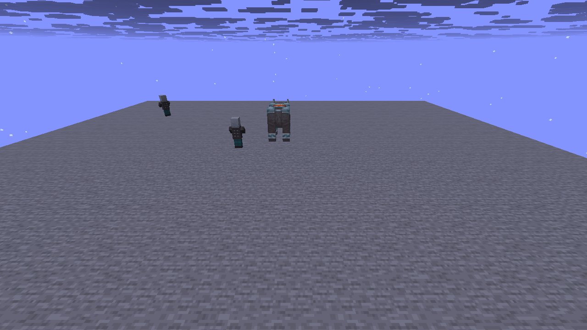
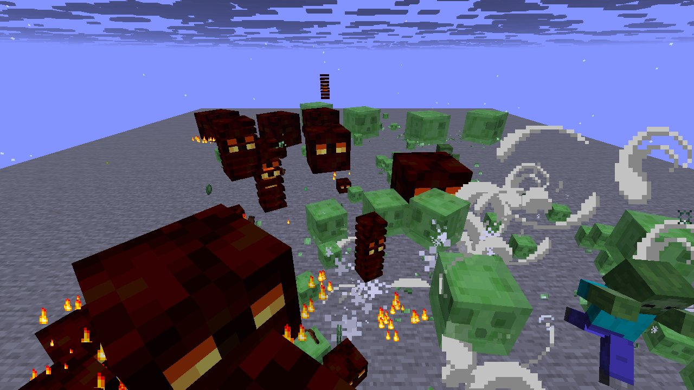

# Mechanic: mobs2

Specific mob behaviours: shields vs ravagers/axes, slimes splitting, phantoms, wololo, cures, conversions.

## In simple terms

The research tracked random number events across four different world seeds. It found that cave carving was the most frequent source of these random draws. Other common sources included vertical gradients and chunk generation. The study also looked at how ores are placed and how items are shuffled.

Written by a local LLM (Qwen3.8-Flash-Next via llama.cpp) from the key numbers below and automatically checked: every number in it appears in those facts. The numbers below are authoritative.

## Key numbers

- 4 runs (4 world seeds), 195,365,636 RNG events, 336 distinct draw sites
- CaveWorldCarver.createTunnel: 69,412,486 draws
- VerticalGradientCondition$1.compute: 16,241,070 draws
- NoiseBasedChunkGenerator.generateCarvers: 15,884,759 draws
- ServerLevel.tickChunk: 13,585,647 draws
- Util.shuffle: 8,428,526 draws
- OreFeature.doPlace: 7,575,134 draws
- InSquarePlacement.modify: 6,170,928 draws
- CanyonWorldCarver.initWidthFactors: 5,200,580 draws

In-game: station 0

In-game: station 1

## How this was produced

Driver script `scenarios/gen/player-mobs2-<seed>.drv` (generated by `tools/gen_player_scenarios.py`), run on 26.3 for 4 world seeds; fake players are real server players named `iwdissi_<role><n>`.

## Files

- [`draw-sites.csv`](draw-sites.csv): every draw site this family exercised, with draw counts
