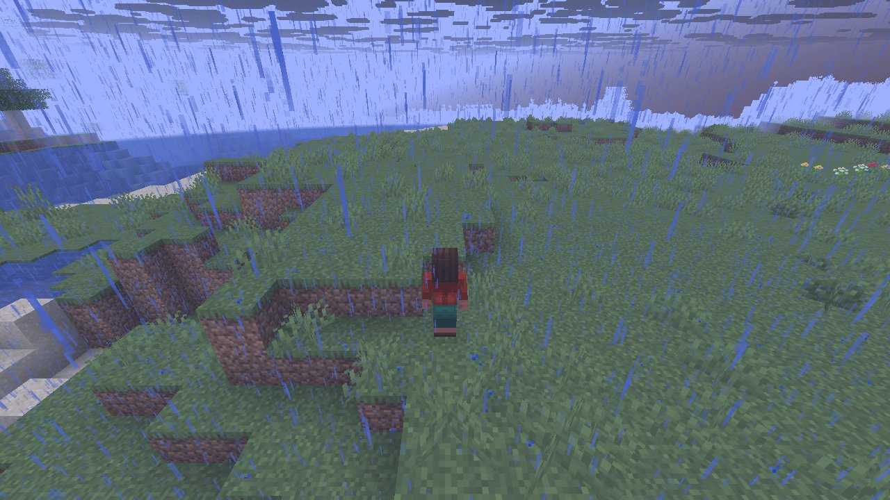
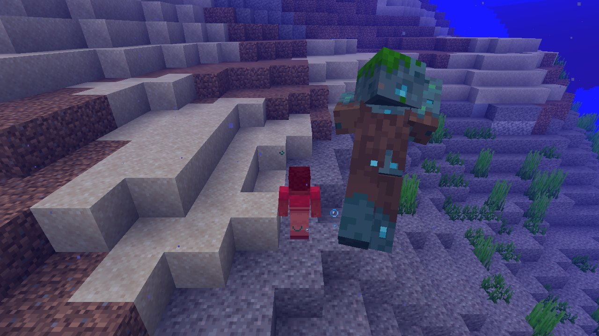

# Mechanic: natural

Natural spawning with time and weather running: patrols, wandering traders, lightning, mob spawns.

## Key numbers

- 4 runs (4 world seeds), 544,931,823 RNG events, 253 distinct draw sites
- CaveWorldCarver.createTunnel: 217,258,425 draws
- VerticalGradientCondition$1.compute: 51,699,112 draws
- NoiseBasedChunkGenerator.generateCarvers: 51,431,655 draws
- ServerLevel.tickChunk: 46,789,512 draws
- OreFeature.doPlace: 21,655,928 draws
- Util.shuffle: 18,664,565 draws
- CanyonWorldCarver.initWidthFactors: 17,232,032 draws
- InSquarePlacement.modify: 13,288,310 draws

In-game: station 0

In-game: station 1

## How this was produced

Driver script `scenarios/gen/player-natural-<seed>.drv` (generated by `tools/gen_player_scenarios.py`), run on 26.3 for 4 world seeds; fake players are real server players named `iwdissi_<role><n>`.

## Files

- [`draw-sites.csv`](draw-sites.csv): every draw site this family exercised, with draw counts
