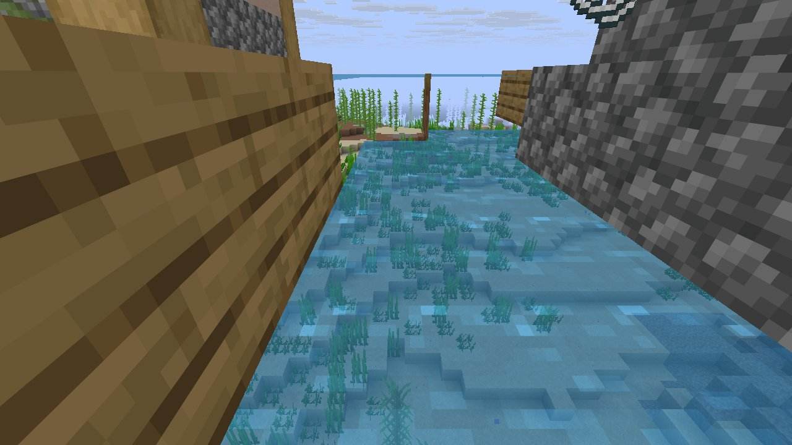
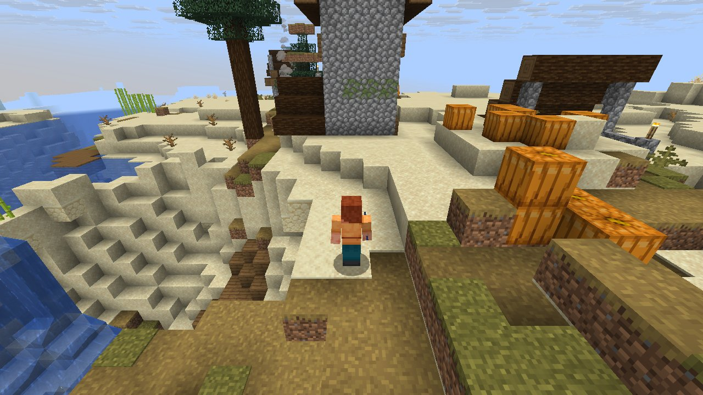

# Mechanic: raids

Scenario family `raids`: fake players `iwdissi_*` exercising this mechanic.

## In simple terms

The researchers used fake players named iwdissi_* to test the raid mechanic across four different world seeds. These tests recorded a total of 635,815,183 random events at 317 specific locations. The most frequent source of these random draws was the creation of tunnels, which accounted for 232,203,344 events. Other significant sources included chunk ticking and noise-based carver generation, each contributing tens of millions of draws.

Written by a local LLM (Qwen3.8-Flash-Next via llama.cpp) from the key numbers below and automatically checked: every number in it appears in those facts. The numbers below are authoritative.

## Key numbers

- 4 runs (4 world seeds), 635,815,183 RNG events, 317 distinct draw sites
- CaveWorldCarver.createTunnel: 232,203,344 draws
- ServerLevel.tickChunk: 63,360,186 draws
- VerticalGradientCondition$1.compute: 55,558,282 draws
- NoiseBasedChunkGenerator.generateCarvers: 54,844,823 draws
- OreFeature.doPlace: 25,868,690 draws
- SpreadingSnowyBlock.randomTick: 22,000,920 draws
- CanyonWorldCarver.initWidthFactors: 19,587,152 draws
- TrapezoidInt.sample: 15,877,788 draws

In-game: station 0

In-game: station 1

## How this was produced

Driver script `scenarios/gen/player-raids-<seed>.drv` (generated by `tools/gen_player_scenarios.py`), run on 26.3 for 4 world seeds; fake players are real server players named `iwdissi_<role><n>`.

## Files

- [`draw-sites.csv`](draw-sites.csv): every draw site this family exercised, with draw counts
