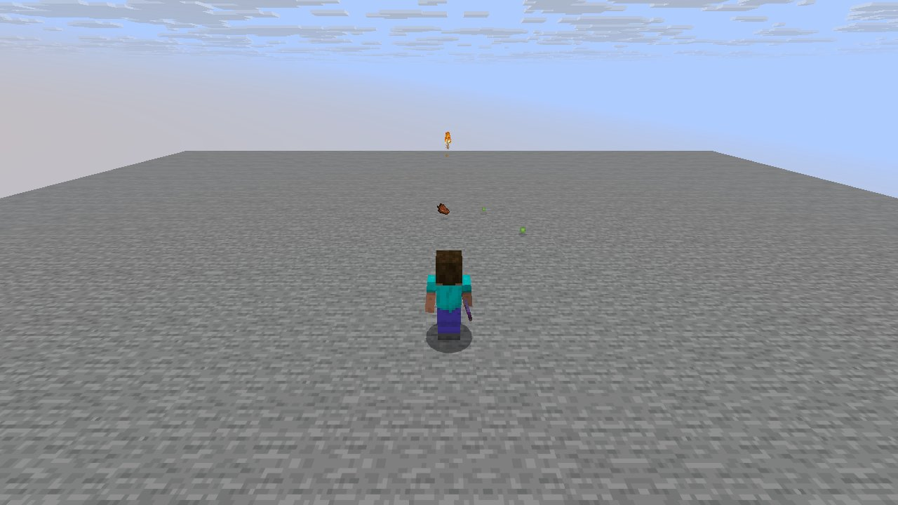
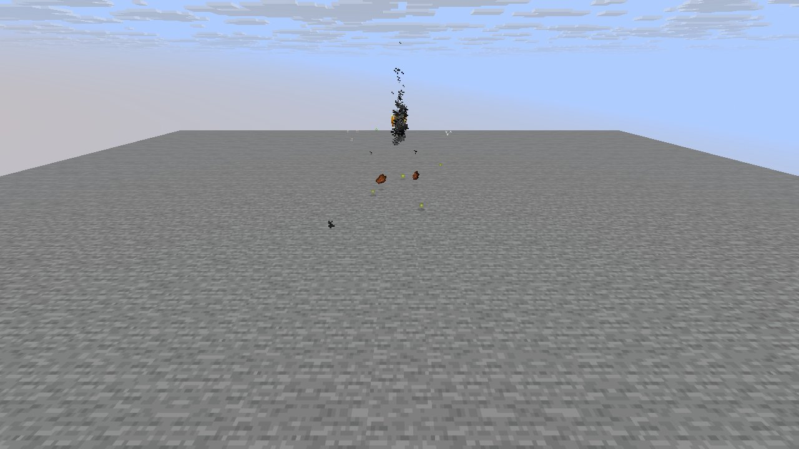

# Mechanic: ranged

Scenario family `ranged`: fake players `iwdissi_*` exercising this mechanic.

## In simple terms

The research tracked fake players using the ranged mechanic across four world seeds. These sessions generated 178,101,348 random events at 268 distinct locations. The most frequent activity was creating tunnels, which accounted for 69,412,486 draws. Other common tasks included calculating vertical gradients and generating carvers.

Written by a local LLM (Qwen3.8-Flash-Next via llama.cpp) from the key numbers below and automatically checked: every number in it appears in those facts. The numbers below are authoritative.

## Key numbers

- 4 runs (4 world seeds), 178,101,348 RNG events, 268 distinct draw sites
- CaveWorldCarver.createTunnel: 69,412,486 draws
- VerticalGradientCondition$1.compute: 16,241,070 draws
- NoiseBasedChunkGenerator.generateCarvers: 15,884,759 draws
- ServerLevel.tickChunk: 13,587,021 draws
- Util.shuffle: 8,330,245 draws
- OreFeature.doPlace: 7,575,032 draws
- InSquarePlacement.modify: 6,170,926 draws
- CanyonWorldCarver.initWidthFactors: 5,200,580 draws

In-game: station 0

In-game: station 1

## How this was produced

Driver script `scenarios/gen/player-ranged-<seed>.drv` (generated by `tools/gen_player_scenarios.py`), run on 26.3 for 4 world seeds; fake players are real server players named `iwdissi_<role><n>`.

## Files

- [`draw-sites.csv`](draw-sites.csv): every draw site this family exercised, with draw counts
