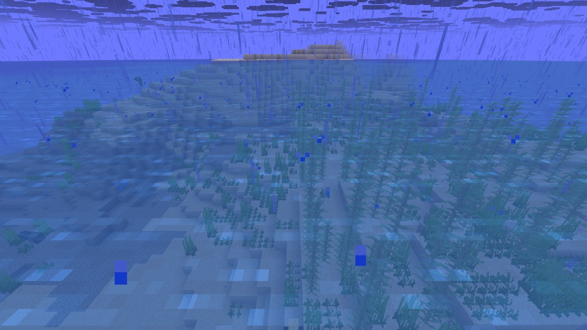
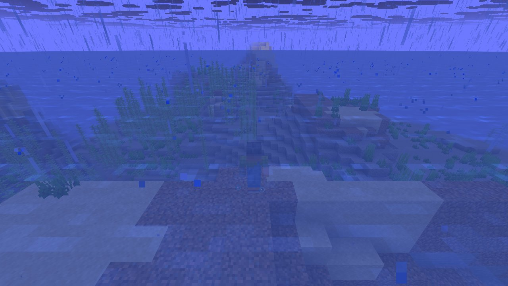

# Mechanic: spawning

Natural spawners with long game time: phantoms, patrols, wandering traders, sieges, biome-specific spawns.

## In simple terms

The researchers tracked random number events across four different world seeds to study how natural spawns work over long periods. They recorded a total of 742,915,913 random draws at 312 specific locations. Most of these events happened during chunk ticking and when creating tunnels in the world. Other significant sources included noise-based carving, snow spreading, and placing ores.

Written by a local LLM (Qwen3.8-Flash-Next via llama.cpp) from the key numbers below and automatically checked: every number in it appears in those facts. The numbers below are authoritative.

## Key numbers

- 4 runs (4 world seeds), 742,915,913 RNG events, 312 distinct draw sites
- ServerLevel.tickChunk: 213,340,842 draws
- CaveWorldCarver.createTunnel: 198,491,582 draws
- VerticalGradientCondition$1.compute: 48,915,754 draws
- NoiseBasedChunkGenerator.generateCarvers: 48,767,719 draws
- SpreadingSnowyBlock.randomTick: 33,826,620 draws
- OreFeature.doPlace: 21,444,456 draws
- Util.shuffle: 19,324,892 draws
- CanyonWorldCarver.initWidthFactors: 16,014,073 draws

In-game: station 0

In-game: station 1

## How this was produced

Driver script `scenarios/gen/player-spawning-<seed>.drv` (generated by `tools/gen_player_scenarios.py`), run on 26.3 for 4 world seeds; fake players are real server players named `iwdissi_<role><n>`.

## Files

- [`draw-sites.csv`](draw-sites.csv): every draw site this family exercised, with draw counts
