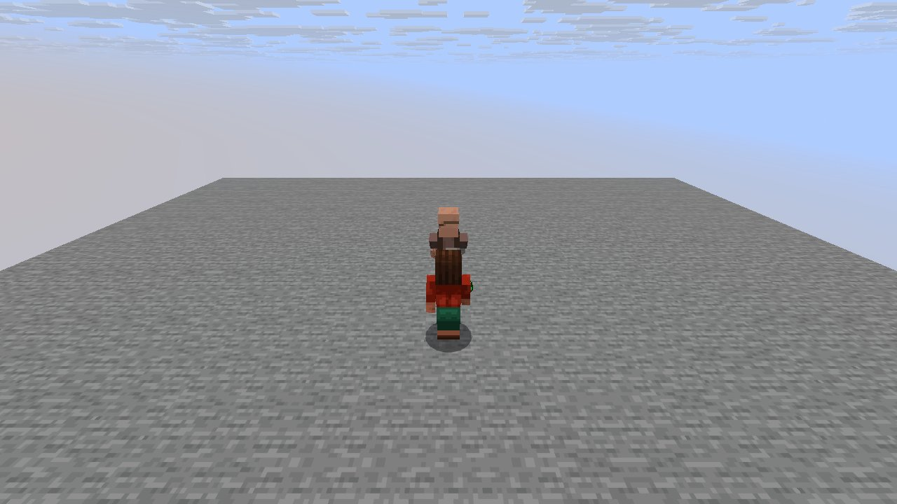
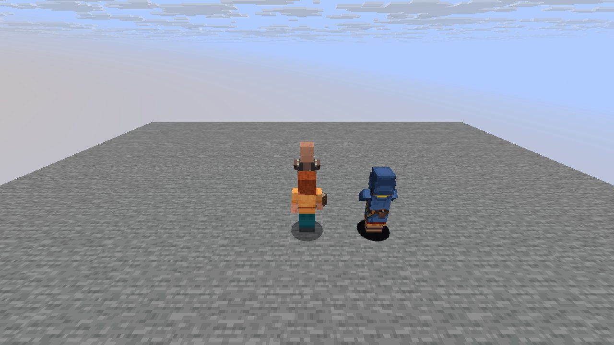

# Mechanic: trading

Scenario family `trading`: fake players `iwdissi_*` exercising this mechanic.

## In simple terms

The trading scenario involved four runs across different world seeds. These runs recorded 186,554,265 random events at 261 distinct locations. The most frequent random draws occurred in the cave tunnel creation code with 72,009,671 events. Other significant activity happened in vertical gradient checks and chunk generation. The status of this specific mechanic's documentation is not provided in the facts.

Written by a local LLM (Qwen3.8-Flash-Next via llama.cpp) from the key numbers below and automatically checked: every number in it appears in those facts. The numbers below are authoritative.

## Key numbers

- 4 runs (4 world seeds), 186,554,265 RNG events, 261 distinct draw sites
- CaveWorldCarver.createTunnel: 72,009,671 draws
- VerticalGradientCondition$1.compute: 17,002,210 draws
- NoiseBasedChunkGenerator.generateCarvers: 16,623,585 draws
- ServerLevel.tickChunk: 13,585,677 draws
- Util.shuffle: 10,141,738 draws
- OreFeature.doPlace: 7,904,498 draws
- InSquarePlacement.modify: 6,383,438 draws
- CanyonWorldCarver.initWidthFactors: 5,453,886 draws

In-game: station 0

In-game: station 1

## How this was produced

Driver script `scenarios/gen/player-trading-<seed>.drv` (generated by `tools/gen_player_scenarios.py`), run on 26.3 for 4 world seeds; fake players are real server players named `iwdissi_<role><n>`.

## Files

- [`draw-sites.csv`](draw-sites.csv): every draw site this family exercised, with draw counts
