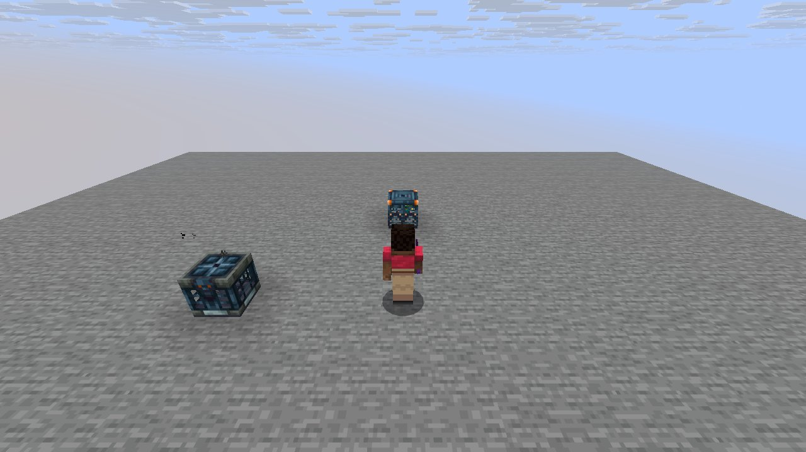
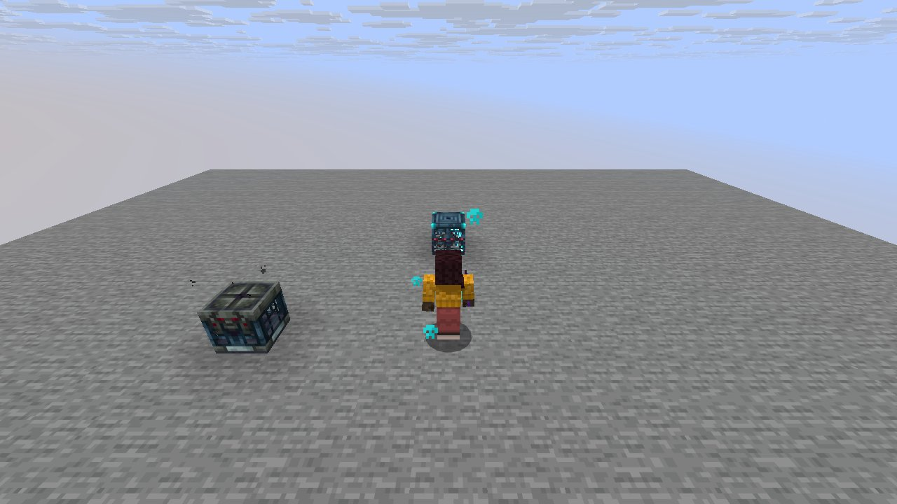

# Mechanic: trials

Scenario family `trials`: fake players `iwdissi_*` exercising this mechanic.

## In simple terms

This research tracks how random choices happen during world generation across four different game seeds. The data shows that creating tunnels was the most frequent source of these random events. Other common activities included shaping terrain height, placing ores, and shuffling items. The study used fake players to observe these mechanics in action.

Written by a local LLM (Qwen3.8-Flash-Next via llama.cpp) from the key numbers below and automatically checked: every number in it appears in those facts. The numbers below are authoritative.

## Key numbers

- 4 runs (4 world seeds), 176,609,308 RNG events, 238 distinct draw sites
- CaveWorldCarver.createTunnel: 69,412,486 draws
- VerticalGradientCondition$1.compute: 16,241,070 draws
- NoiseBasedChunkGenerator.generateCarvers: 15,884,759 draws
- ServerLevel.tickChunk: 13,565,730 draws
- Util.shuffle: 8,286,805 draws
- OreFeature.doPlace: 7,574,862 draws
- InSquarePlacement.modify: 6,170,924 draws
- CanyonWorldCarver.initWidthFactors: 5,200,580 draws

In-game: station 0

In-game: station 1

## How this was produced

Driver script `scenarios/gen/player-trials-<seed>.drv` (generated by `tools/gen_player_scenarios.py`), run on 26.3 for 4 world seeds; fake players are real server players named `iwdissi_<role><n>`.

## Files

- [`draw-sites.csv`](draw-sites.csv): every draw site this family exercised, with draw counts
