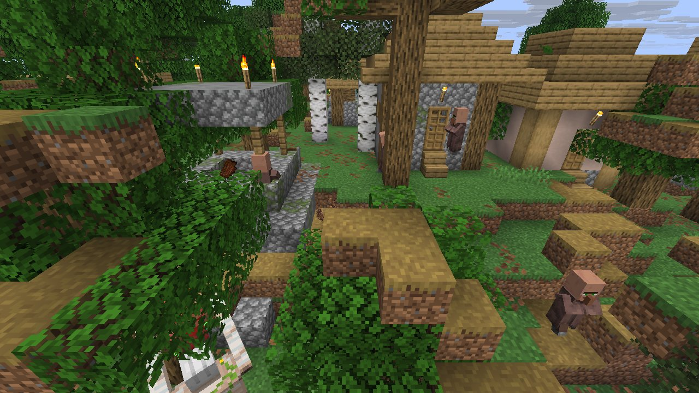
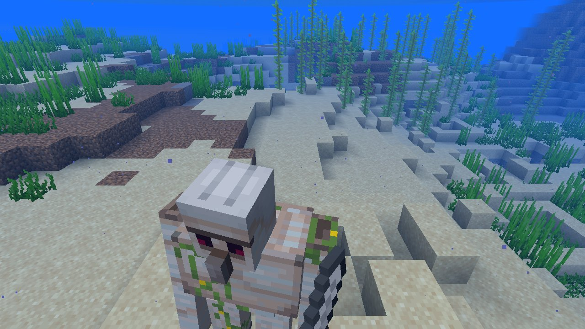

# Mechanic: villages

Villager life with time running: breeding, farming, gossip, gifts to a hero, bells, sieges, raid wins.

## In simple terms

The researchers ran four separate worlds to track how random events affect village life. They recorded nearly a billion random number draws across 348 different locations. Most of these draws happened during general world ticking and cave creation. Other significant activity occurred during snow spreading and ore placement.

Written by a local LLM (Qwen3.8-Flash-Next via llama.cpp) from the key numbers below and automatically checked: every number in it appears in those facts. The numbers below are authoritative.

## Key numbers

- 4 runs (4 world seeds), 972,175,323 RNG events, 348 distinct draw sites
- ServerLevel.tickChunk: 253,668,280 draws
- CaveWorldCarver.createTunnel: 229,722,223 draws
- VerticalGradientCondition$1.compute: 55,198,822 draws
- NoiseBasedChunkGenerator.generateCarvers: 54,844,823 draws
- SpreadingSnowyBlock.randomTick: 53,456,232 draws
- OreFeature.doPlace: 26,226,088 draws
- CanyonWorldCarver.initWidthFactors: 21,287,822 draws
- MarsagliaPolarGaussian.nextGaussian: 21,083,932 draws

In-game: station 0

In-game: station 1

## How this was produced

Driver script `scenarios/gen/player-villages-<seed>.drv` (generated by `tools/gen_player_scenarios.py`), run on 26.3 for 4 world seeds; fake players are real server players named `iwdissi_<role><n>`.

## Files

- [`draw-sites.csv`](draw-sites.csv): every draw site this family exercised, with draw counts
