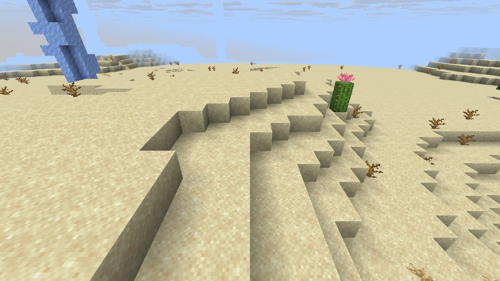
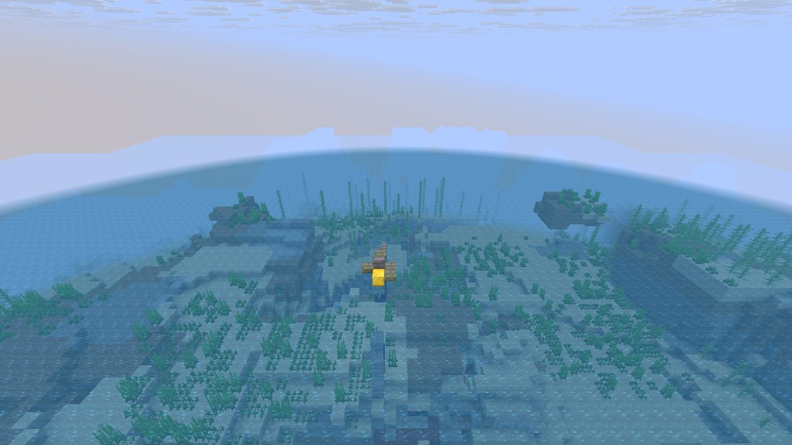

# Mechanic: worldgen2

Features and structures that failed to place earlier: give them the terrain they need.

## In simple terms

This research looks at why certain world features failed to generate in four specific game worlds. The team tracked over two billion random events across 337 different locations to find the cause. Most of these random checks happened while creating tunnels and updating chunks. The study aims to give these features the correct terrain conditions so they can place successfully.

Written by a local LLM (Qwen3.8-Flash-Next via llama.cpp) from the key numbers below and automatically checked: every number in it appears in those facts. The numbers below are authoritative.

## Key numbers

- 4 runs (4 world seeds), 2,062,398,021 RNG events, 337 distinct draw sites
- CaveWorldCarver.createTunnel: 768,730,794 draws
- ServerLevel.tickChunk: 200,512,270 draws
- VerticalGradientCondition$1.compute: 184,961,066 draws
- NoiseBasedChunkGenerator.generateCarvers: 184,940,635 draws
- OreFeature.doPlace: 83,518,140 draws
- SpreadingSnowyBlock.randomTick: 74,073,612 draws
- CanyonWorldCarver.initWidthFactors: 64,074,079 draws
- MarsagliaPolarGaussian.nextGaussian: 54,921,244 draws

In-game: station 0

In-game: station 1

## How this was produced

Driver script `scenarios/gen/player-worldgen2-<seed>.drv` (generated by `tools/gen_player_scenarios.py`), run on 26.3 for 4 world seeds; fake players are real server players named `iwdissi_<role><n>`.

## Files

- [`draw-sites.csv`](draw-sites.csv): every draw site this family exercised, with draw counts
