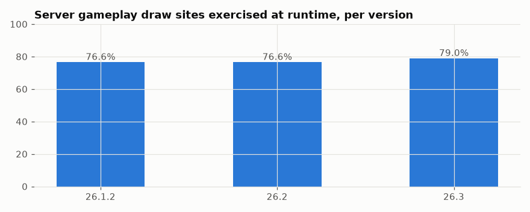

# Cross-version check: 26.1.2, 26.2 and 26.3

The whole runtime process (every scenario family, the replay check, the correlation analysis and the rediscovery checklist) repeated on the three most recent releases, to see whether the findings hold.

## In simple terms

Researchers re-ran their full testing process on versions 26.1.2, 26.2, and 26.3 to see if previous findings still apply. All three versions showed zero mismatches and successfully rediscovered all 19 known facts. The tests confirmed that piglin dances are tied to game time and enchantment slots use specific reseeding rules. While the number of classes sharing random data increased slightly in newer versions, the core behaviors remained consistent across all releases.

Written by a local LLM (Qwen3.8-Flash-Next via llama.cpp) from the key numbers below and automatically checked: every number in it appears in those facts. The numbers below are authoritative.

## Key numbers

- 26.1.2: 146 runs, 12,493,552,328 events, 0 mismatches, coverage 76.6%, rediscovered 19 of 19 known facts
- 26.1.2: piglin dance seeded by game time = True, enchant slots reseeded seed+slot = True, enchant first-draw r = 0.916, structure palette r = 0.504, Level.random shared by 226 classes
- 26.2: 145 runs, 12,478,981,084 events, 0 mismatches, coverage 76.6%, rediscovered 19 of 19 known facts
- 26.2: piglin dance seeded by game time = True, enchant slots reseeded seed+slot = True, enchant first-draw r = 0.915, structure palette r = 0.504, Level.random shared by 228 classes
- 26.3: 148 runs, 12,111,530,459 events, 0 mismatches, coverage 79.0%, rediscovered 19 of 19 known facts
- 26.3: piglin dance seeded by game time = True, enchant slots reseeded seed+slot = True, enchant first-draw r = 0.917, structure palette r = 0.502, Level.random shared by 230 classes

Coverage per version

## How this was produced

`tools/run_many.py --version <v>` for each version, then `tools/cross_version.py` (analysis restricted to that version's runs). Static scans of 1.21.11, 1.16.1 and 1.12.2 are in ../01-static-catalog and ../03-version-diffs.

## Files

- [`cross-version.csv`](cross-version.csv): key numbers per version
- [`rediscovery-26.1.2.csv`](rediscovery-26.1.2.csv): rediscovery checklist for 26.1.2
- [`rediscovery-26.2.csv`](rediscovery-26.2.csv): rediscovery checklist for 26.2
- [`rediscovery-26.3.csv`](rediscovery-26.3.csv): rediscovery checklist for 26.3
- [`coverage-by-version.png`](coverage-by-version.png): chart

| Version | Runs | Events | Mismatches | Coverage | Rediscovered | Piglin game-time seed | Enchant r | Palette r |
|---|---|---|---|---|---|---|---|---|
| 26.1.2 | 146 | 12,493,552,328 | 0 | 76.6% | 19/19 | True | 0.916 | 0.504 |
| 26.2 | 145 | 12,478,981,084 | 0 | 76.6% | 19/19 | True | 0.915 | 0.504 |
| 26.3 | 148 | 12,111,530,459 | 0 | 79.0% | 19/19 | True | 0.917 | 0.502 |
